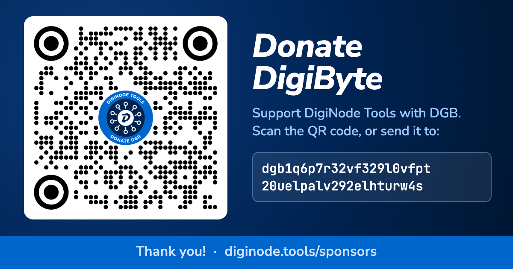

<!-- Made from sponsor-info.json by scripts/build-text.py - edit sponsor-info.json, not this file. -->
# Text for GitHub Sponsors and Ko-fi

GitHub Sponsors and Ko-fi can't be updated automatically, so this is the text to paste into them. When it changes, the **Build sponsor text** Action opens an issue saying what to update. Paste each box exactly as it is.

## GitHub Sponsors

[Profile](https://github.com/sponsors/DigiNode-Tools/dashboard/profile) > **Introduction** (markdown):

```text
### Help me spend more time on DigiNode Tools

DigiNode Tools lets anyone set up, monitor and manage a DigiByte Node, with minimal technical knowledge needed. It's free to use, and its code is public, so anyone can audit it and see exactly what it does on their node. The more people who sponsor me, the more time I can devote to it.

Every monthly tier includes the Sponsors Preview: get each new release of DigiNode Tools two weeks before everyone else.

**What your support pays for, and what I'm building next: [diginode.tools/sponsors](https://diginode.tools/sponsors/)**

Prefer to give once? You can also make a one-time donation on [Ko-fi](https://ko-fi.com/diginode).

#### Donate DigiByte

Prefer to donate DGB? Scan the QR code, or copy the address from [diginode.tools/sponsors](https://diginode.tools/sponsors/).



Thank you for your support!

Olly
[diginode.tools](https://diginode.tools) · [@diginode.tools on Bluesky](https://bsky.app/profile/diginode.tools) · [@olly.st on Bluesky](https://bsky.app/profile/olly.st)
```

[Sponsor tiers](https://github.com/sponsors/DigiNode-Tools/dashboard/tiers) - monthly tiers (name, price, description):

**💙 Supporter** - $10 a month

```text
Help me keep working on DigiNode Tools. Every sponsor gives me more time to improve it. Thank you!

Includes the Sponsors Preview: get each new release of DigiNode Tools two weeks before everyone else.
```

**🖥️ Node Runner** - $25 a month

```text
For DigiNode operators who want DigiNode Tools to keep improving. This makes a real difference to how much time I can give it.

Includes the Sponsors Preview: get each new release of DigiNode Tools two weeks before everyone else.
```

**🏆 Champion** - $50 a month

```text
Helps me devote serious time to new features and improvements for DigiNode Tools. A big thank you!

Includes the Sponsors Preview: get each new release of DigiNode Tools two weeks before everyone else.
```

**🌟 Patron** - $100 a month

```text
Directly funds a meaningful part of my time on DigiNode Tools. As a thank you, you'll be listed on the diginode.tools/sponsors page.

Includes the Sponsors Preview: get each new release of DigiNode Tools two weeks before everyone else.
```

**🚀 Featured Sponsor (only 3 places)** - $300 a month

```text
For businesses and projects who want to reach the people running DigiByte Nodes. Your logo and link appear on the diginode.tools home page, sponsors page and every blog post, the DigiNode Tools GitHub page, and in DigiNode Tools itself: a one-line text link shown when DigiNode Setup finishes and DigiNode Dashboard closes. Featured Sponsors are approved by me. If your sponsorship isn't approved, it will be refunded.

Includes the Sponsors Preview: get each new release of DigiNode Tools two weeks before everyone else.

After sponsoring, add your logo here: https://github.com/DigiNode-Tools/diginode-sponsors/issues/new?template=featured-sponsor.yml
```

One-time tiers: $25, $50, $100, $250 (plus a custom amount).

## Ko-fi

[Settings > Profile](https://ko-fi.com/settings) > **About you** (Ko-fi allows 900 characters):

```text
Hi, I'm Olly. DigiNode Tools lets anyone set up, monitor and manage a DigiByte Node, with minimal technical knowledge needed. It's free to use, and its code is public, so anyone can audit it and see exactly what it does on their node. The more people who sponsor me, the more time I can devote to it.

What your support pays for, and what I'm building next: diginode.tools/sponsors/

One-time donations here are really appreciated. If you'd like to sponsor me monthly, please do it on GitHub Sponsors: every monthly sponsor gets the Sponsors Preview, with each new release of DigiNode Tools two weeks before everyone else. github.com/sponsors/DigiNode-Tools

Thank you!
Olly
```

[Settings > Payment](https://ko-fi.com/settings?tab=payment) > **suggested amounts**: 25, 50, 100 (US $).

[Memberships](https://ko-fi.com/memberships/settings): **no monthly tiers** - monthly sponsorship is on GitHub Sponsors only. Ko-fi is for one-time donations. (Turning monthly tips off completely costs 5% of tips, so the tiers are kept as unpublished drafts instead.)

[Settings](https://ko-fi.com/settings) > **Thank you message** (sent after each tip):

```text
Thank you so much for supporting DigiNode Tools! It really does help me spend more time on it. If you'd ever like to sponsor monthly, GitHub Sponsors gives you the Sponsors Preview: each new release two weeks before everyone else. github.com/sponsors/DigiNode-Tools - Olly
```

The pinned post (**Support DigiNode Tools**, with the Ko-fi banner as its image - not the DGB card, which would go out of date when the address changes):

```text
DigiNode Tools lets anyone set up, monitor and manage a DigiByte Node, with minimal technical knowledge needed. It's free to use, and its code is public, so anyone can audit it and see exactly what it does on their node. The more people who sponsor me, the more time I can devote to it.

See what your support pays for, and what I'm building next: https://diginode.tools/sponsors/

Donate DigiByte
Prefer to donate DGB? The address to send it to, with its QR code, is on the sponsors page: https://diginode.tools/sponsors/

One-time donations here are really appreciated. If you'd like to sponsor me monthly, please do it on GitHub Sponsors: every monthly sponsor gets the Sponsors Preview, with each new release of DigiNode Tools two weeks before everyone else. https://github.com/sponsors/DigiNode-Tools

Thank you for your support!
Olly
```
